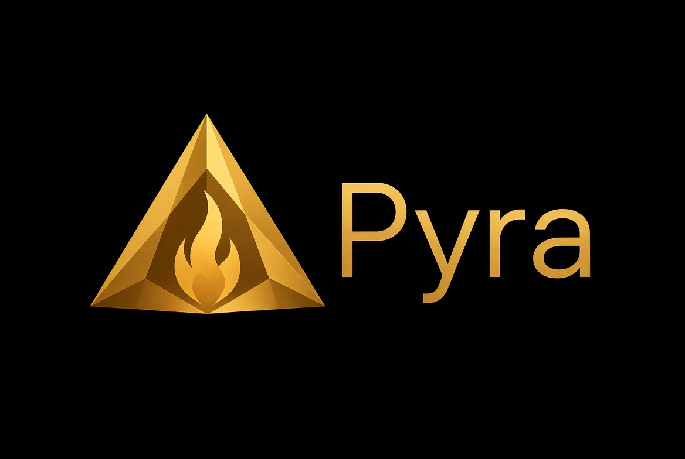

# Pyra

**Formerly [python-gate](https://github.com/Hedronite/python-gate).** The repository moved to [Hedronite/pyra](https://github.com/Hedronite/pyra); GitHub still redirects the old URL.

Pyra is a closed-world hybrid runtime for Python, aimed at ML work. Nix is the gate. uv owns the expression. `nix run` is the product.

**This is a GitHub template.** Use it as *Use this template*, or:

```bash
nix flake new -t github:Hedronite/pyra ./my-app
```

What this tree builds today is Level 3: pure Python, one virtualenv, a wrapped application. CUDA, PyO3, and Bend are the Level 4 direction, described below. They are not in this tree.

`mkVirtualEnv` / `withPackages` builds a world; `mkApplication` / `wrapProgram` locks the door; nix-ld is the FHS lie (Level 2).

A Python shop that is not on NixOS still `uv sync`s from `uv.lock`. A Nix user or CI `nix develop`s and `nix run .#`s the same closure. Two proofs: `uv.lock` (packages) and `flake.lock` (builders). **A lockfile is not a closure.**

This repository is the working example *and* the cloneable template.

## The ladder

| Level | What you have | Where it stands |
| --- | --- | --- |
| 0 | Host Python, `pip install` | No lock, no world, no product |
| 1 | `uv.lock` / `poetry.lock` | Packages are pinned. Builders are still the host. Not a closure |
| 2 | nix-ld / steam-run / `LD_LIBRARY_PATH` | A wheel can run. This is the FHS lie: not bit-identical |
| **3** | **uv2nix `mkVirtualEnv` + `mkApplication`. This template, today** | Pure Python. The closure is the product |
| 4 | The same closure, plus native code that Nix evaluated in | Direction only. PyO3/maturin kernels, Bend 2 components with machine-checked laws, optional CUDA. Not in this tree |

Level 2 can run a wheel. It is not a closed world. It is not bit-identical.

## Direction

Level 4 is the evolution being explored: one Nix store path in which ordinary Python, PyO3/Rust extensions, and Bend 2 components can coexist. The product would still be `nix run`. The pure-Python inner loop would stay available, and would stay the default for packages that need nothing else. Proof failures, where a Bend component is present, would fail the build. The same closure would serve a person and an agent.

Nothing in this section is implemented in this repository. Read it as a direction and a set of open questions.

The shape under discussion is three layers, still one project:

- **Control plane.** Orchestration, data, tracking, experiments, serving, tool interfaces. Ordinary Python, managed by uv, realized by uv2nix. This is what Level 3 already is.
- **Kernel plane.** Two extension mechanisms, both built inside the Nix evaluation and installed into the same virtualenv. PyO3/maturin for memory-safe or ecosystem-shaped kernels (sampling, tokenizers, loaders, rust-numpy, small CUDA kernels). Bend 2 for components whose correctness properties are stated as laws and checked by the Bend compiler before the extension exists — shape-safe transforms, proved round-trips, tree-parallel reductions, policy components.
- **The closed world as the runtime.** People and agents work inside `nix develop` or against the wrapped product, and call those kernels as ordinary Python functions.

Packaging would stay on the current base: a flake using pyproject-nix, uv2nix, and pyproject-build-systems. Pure Python would keep the Level 3 path. A PyO3 package would declare the maturin build backend, bring a `Cargo.lock`, and be injected into the uv2nix set. A Bend component would ship `.bend` sources, `LAWS.bend`, and `PROOF.bend`; the derivation would run a pinned Bend compiler. CUDA would be an optional overlay. Default configurations would stay CPU-only.

The dev shell would keep the peace treaty and, when asked, offer rustc, maturin, crane, and a pinned Bend binary.

Open questions:

- Should PyO3 packages be built with crane, for incremental Rust caching, or is a lighter Cargo lock import plus build-system overlays enough?
- What is the bridge from Bend 2 into CPython: a maintained bend-python build, or a thin CFFI/PyO3 wrapper around Bend-generated C?
- The intent is that an open or false proof stops the product. How should `LAWS.bend` and `PROOF.bend` be wired so that holds, and so the extension imports from the same interpreter as the pure Python?
- How is the CUDA overlay selected so it stays opt-in, and so CPU and CUDA are each one closure rather than a leak between the two?
- Agent grading today is flake eval, an import inside the declared env, `uv sync --locked`, and the same closure. When a project contains Bend components, that list would grow a proof check. What is the smallest CI addition that does that and stays quiet for pure-Python projects?
- What should the reference template contain once any of this is real: one pure-Python control-plane example (this repo, now), one non-trivial PyO3 extension, one non-trivial Bend 2 component, and a documented CUDA recipe?

The kinds of work this is aimed at: specialist-model fine-tuning and distillation where a kernel or an evaluation gate is proved; shape-safe data planes that hand arrays to PyTorch or JAX; policy or tool components with machine-checked behavior; a training or inference artifact any collaborator can `nix run`. Dense contiguous linear algebra stays in PyTorch or JAX. Maturin and a Bend bridge are the two extension paths being considered first. Other native build systems can join later through the same overlay mechanism. CPU and proofs are the part to get right first; Bend's GPU backends are a later question, wherever those backends themselves allow it.

The peace treaty and the dual-lockfile model stay. Level 2 stays a named escape hatch.

If you are cloning the template today, you are cloning Level 3.

## Init

```bash
# GitHub template, or:
nix flake new -t github:Hedronite/pyra ./my-app
cd ./my-app

# Rename the project when you clone it:
# - pyproject.toml [project] name and [project.scripts]
# - src/<module>/
# - tool.uv.build-backend.module-name
# - projectName in flake.nix
# This repo keeps a python-gate script and a python_gate module as aliases
# for the old name. Drop both in your project.
uv lock
```

Without Nix (inner loop):

```bash
uv sync
uv run pyra
```

`uv run python-gate` runs the same entry point. That alias exists so the old script name keeps working.

With Nix (same world, locked door):

```bash
nix develop          # store venv + peace treaty
nix run .#           # the product; network-free
```

`nix run .#python-gate` is the same product under the old app name.

## Add a dependency

uv writes the expression. Nix consumes it. Do not hand-translate `uv.lock` into `python3Packages`.

```bash
uv add httpx         # or any pure-Python wheel uv2nix can eat
git add uv.lock pyproject.toml
nix run .#           # rebuilds the world from the new lock
git add flake.lock   # only if flake inputs moved
git commit
```

Commit **both** lockfiles. `uv.lock` pins packages. `flake.lock` pins builders. Either one alone is a story, not a closure.

## Peace treaty (dev shell)

The Nix shell and uv share one interpreter. They do not share authority over the environment.

| Variable | Value | Why |
| --- | --- | --- |
| `UV_NO_SYNC` | `1` | uv must not provision a second venv |
| `UV_PYTHON` | the Nix interpreter | one Python set |
| `UV_PYTHON_DOWNLOADS` | `never` | Nix owns the interpreter |
| `PYTHONPATH` | unset in `shellHook` | kill nixpkgs `PYTHONPATH` leakage |

On NixOS, if you must run an **unpatched** FHS binary, set `NIX_LD` and `NIX_LD_LIBRARY_PATH` (nix-ld). **Never set `LD_LIBRARY_PATH` as the default.** That is a Level 2 leak into a Level 3 world.

## Closed-world rules

These keep the Level 3 world one world. They are the rules of what this template builds today.

- One venv: the store env. A `.venv` beside it is a second world. Inside `nix develop`, that is what a bare `uv run` grows.
- uv + uv2nix. poetry2nix is unmaintained.
- Level 2 (nix-ld / `LD_LIBRARY_PATH`) is not bit-identical.
- `uv.lock` and `flake.lock` are generated. They are not hand-edited.
- Dependencies enter through uv. They are not a hand-written `python3Packages` translation.
- On NixOS, `LD_LIBRARY_PATH` is not the default. An unpatched FHS binary uses `NIX_LD` and `NIX_LD_LIBRARY_PATH`.

## Agent grading

A change is done when all of these pass:

1. **Flake eval.** `nix flake show` lists `packages.<system>.default`, `apps.<system>.default`, `devShells.<system>.default`, and `templates.default`. Systems: `x86_64-linux`, `aarch64-linux`, `aarch64-darwin` (nixos-unstable dropped Intel Macs). `apps.python-gate` is the old app name, still present.
2. **Import inside the declared env.** `nix develop --command python -c "import pyra, python_gate, rich"` succeeds. `python_gate` is the alias of `pyra`.
3. **`uv sync --locked`.** The non-Nix inner loop still reproduces from `uv.lock`. `uv run pyra` and `uv run python-gate` both run.
4. **Same closure.** `nix run .#` and `nix develop` use the same Python set (same interpreter, same uv2nix overlay). The product is the wrapped application, not a hope.

CI on `ubuntu-latest` runs `nix build` / `nix run` (Determinate Nix) and `uv sync --locked` (setup-uv). Green means both proofs held, not that one was skipped.

A future Bend proof check belongs on this list only once a project contains Bend components. It is not part of grading today.

## Names

| | Current | Alias kept |
| --- | --- | --- |
| Distribution | `pyra` | |
| Import | `import pyra` | `import python_gate` |
| Console script | `pyra` | `python-gate` |
| `nix run` | `nix run .#` (`apps.default` runs `bin/pyra`) | `nix run .#python-gate` |
| Flake check | `pyra-runs` | `python-gate-runs` (same derivation) |
| Template | `templates.default` | URL is `github:Hedronite/pyra`. The output name is `default` |

`packages.default`, `devShells.default`, and `templates.default` kept their attribute names.

## Example app

`src/pyra` is a console script plus `rich`. `src/python_gate` re-exports it. `nix run .#` prints versions and `square(12)` — a pure function, no HTTP. That is the point: the closure is enough.

## Further reading

Short doctrine, and the Level 4 notes: [`docs/theses.md`](docs/theses.md).

Upstream builders (2026 map — do not use last year's):

- [uv](https://docs.astral.sh/uv/)
- [uv2nix](https://pyproject-nix.github.io/uv2nix/)
- [pyproject.nix](https://pyproject-nix.github.io/pyproject.nix/)
- [pyproject-build-systems](https://github.com/pyproject-nix/build-system-pkgs)

## License

MIT. Copyright Hedronite 2026.
